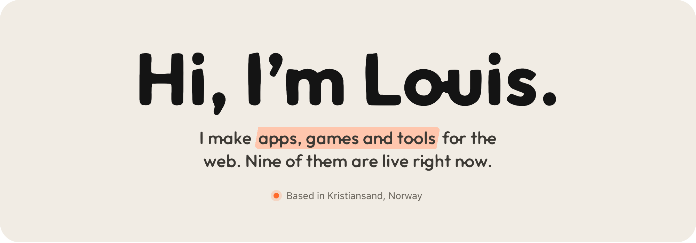
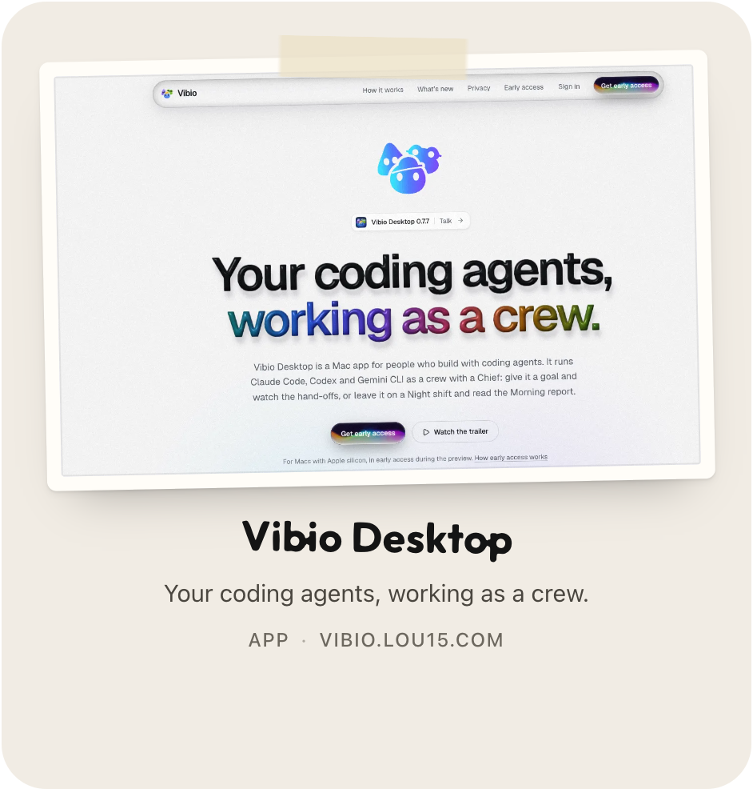
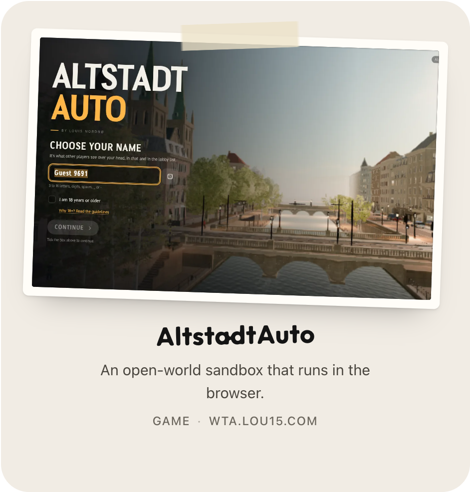
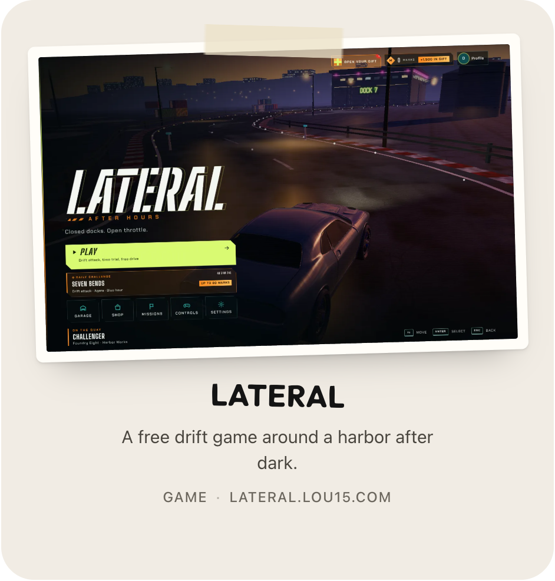
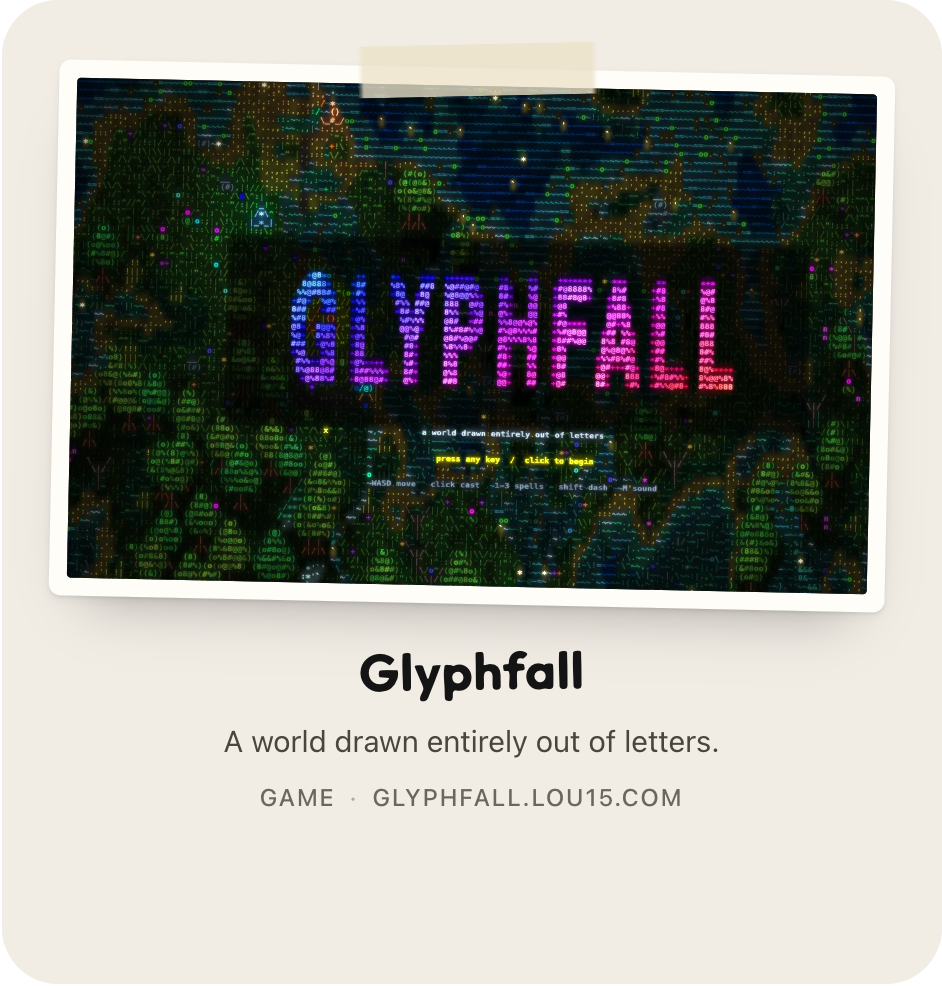
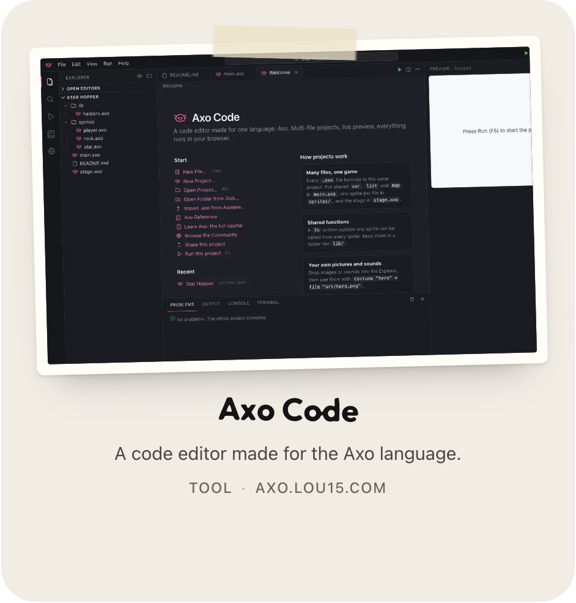
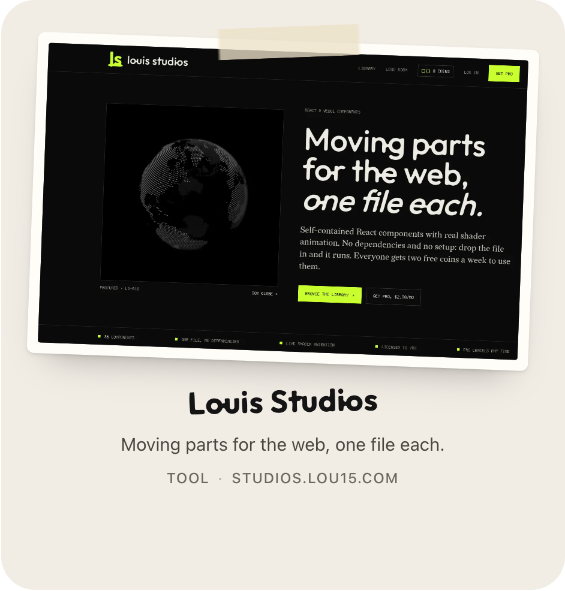
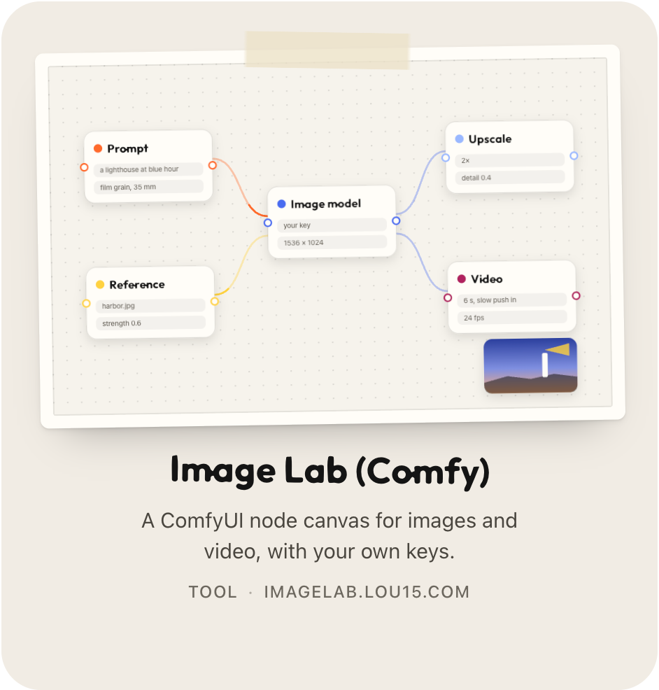
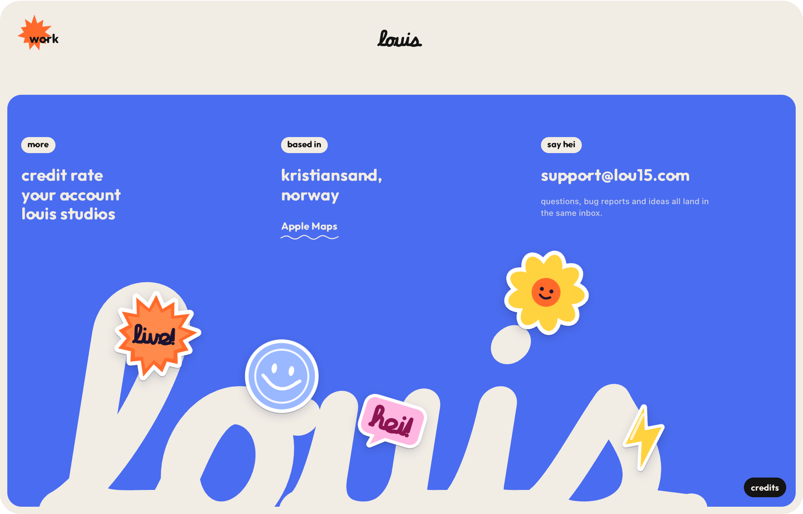

  

<h3 align="center">Here’s what I’ve been making</h3>

  
  
  
  
  
  
  
  
  

<h3 align="center">Open source</h3>

  <a href="https://github.com/Louistuis/LATERAL-After-Hours"><b>LATERAL: After Hours</b></a>, the drift game, in TypeScript with three.js and Rapier 
  <a href="https://github.com/Louistuis/AltstadtAuto-OldTown-MapPack"><b>AltstadtAuto Old Town</b></a>, the game’s old-town world: code, prompts and a viewer 
  <a href="https://github.com/Louistuis/chess-analysis-extension"><b>Chess analysis</b></a>, Stockfish arrows over chess.com boards, for analysis and practice 
  <a href="https://github.com/Louistuis/Kinesis"><b>Kinesis</b></a>, an autonomous macOS desktop agent for the command line (beta)

  

